# TradeDesk

A Windows desktop app for market research with AI agents that run on your own computer. It wraps the open-source [TradingAgents](https://github.com/TauricResearch/TradingAgents) framework, runs it with a local model through Ollama, feeds it your real holdings, and keeps a journal that scores its calls against what the market did.

> **It is a research aid.** It places no orders, has no broker connection, and nothing it says is financial advice or a recommendation to buy or sell. Language models can be confidently wrong. You make the decision.

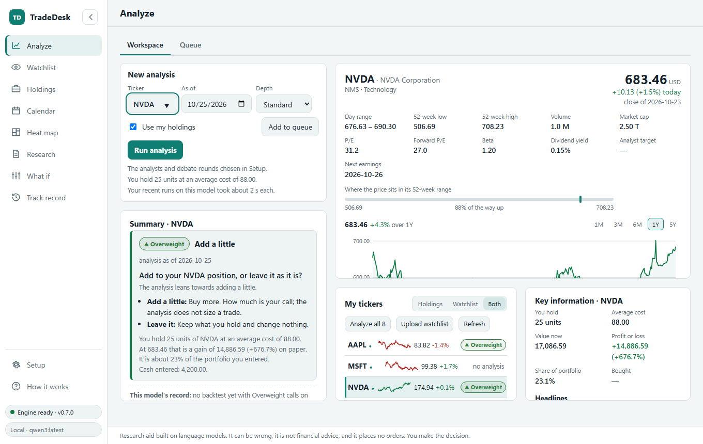

*Screenshots in this file use an invented sample portfolio, a stand-in model and made-up prices, so figures can differ between screens. They show the layout, not real results. `docs/make-screenshots.js` regenerates them.*

## Contents

- [What it does](#what-it-does)
- [Screens](#screens)
- [How an analysis works](#how-an-analysis-works)
- [Install](#install)
- [Apps and tools it uses](#apps-and-tools-it-uses)
- [Using it](#using-it)
- [Your data and privacy](#your-data-and-privacy)
- [Limits you should know about](#limits-you-should-know-about)
- [Not verified](#not-verified)
- [Development](#development)
- [Project layout](#project-layout)
- [Licence, credits and disclaimer](#licence-credits-and-disclaimer)

## What it does

- **Analyzes a ticker** with a team of agents (market, sentiment, news and fundamentals analysts, a bull and a bear researcher, a trader and a risk team) and ends in a plain-language briefing: the decision that is yours, the reasons for and against, and what would change the call.
- **Knows your holdings.** Import from Excel, CSV or a pasted table. The agents see what you own, so "add to a position" and "open a new one" are different answers.
- **Keeps score.** A journal compares each call with the benchmark, and a backtest runs the agents over past dates, so you can judge a model before you trust it.
- **Reads the public record.** SEC filings, reported quarterly results and House stock disclosures, plus price alerts you set yourself.
- **Shows what an amount could cost you.** A "What if" screen takes an amount of cash you already hold and shows the loss arithmetic, what the stock did before and the risks of each way of going about it. It never says what to do or how much.
- **Shows the market around you.** Statistics and charts per ticker, a sortable and editable holdings table with candle charts, and a calendar of the events that move prices, with what the market did when a past one happened.
- **Installs what it needs.** A Setup screen lists Python, the engine, Ollama and your models, says what is missing, and installs each from inside the app.
- **Stays on your computer.** With a local model, no prompt or holding goes to a model company.

## Screens

| Screen | Purpose |
|---|---|
| **Analyze** | A four-pane workspace. Left: a compact new-analysis form (ticker, date, depth) and the summary. Right top: the selected ticker's price, day and 52-week range, volume, market cap, P/E, beta, dividend yield, analyst target, next earnings and a chart. Right bottom: My tickers (holdings, watchlist and recent analyses with sparklines and the latest rating, with a Holdings, Watchlist, Both selector and an **Analyze all** button for the list shown) and Key information (your position and today's headlines). The **Queue** tab lines up several analyses: remove one, stop the running one, or Cancel all. |
| **Watchlist** | Upload a spreadsheet of tickers with buy zones, or add one by one. A list on the left, the selected ticker's chart and latest briefing on the right. A **Holdings, Watchlist, Both** selector beside the sort keeps stocks you own apart from stocks you only follow. Queue the list shown or one ticker. |
| **Holdings** | Summary tiles, an allocation chart, profit or loss by position, a sortable positions table and a "holdings over time" chart. |
| **Calendar** | A month grid and an agenda side by side, and below them what the market did around any past event. Drag the dividers to resize each pane; each pane scrolls on its own. |
| **Heat map** | A treemap of about 100 large US companies by sector, coloured by price change over a day, week, month or three months, or of your own holdings and watchlist. Click a tile to open it in Analyze. |
| **Research** | Four tabs: **Filings** (8-Ks, 10-Qs, 10-Ks from SEC EDGAR, with items named in plain words), **Company results** (revenue, profit, margins and EPS by quarter from SEC data), **Congress trades** (House periodic transaction reports) and **Price alerts**. |
| **What if** | A scenario calculator for cash you already hold. See below. |
| **Track record** | **Journal** (every analysis, scored against the benchmark) and **Backtest** (the agents over past dates). |
| **Setup** | Four tabs: Components, Model and run settings, API keys, This computer. |
| **How it works** | What the app does, how to read a result, where numbers come from, limits and terms of use. |

### Analyze and the briefing

Every result starts with a briefing. A "decision for you" card states the choice (for example "Add to your NVDA position, or leave it as it is?"), your position and cash, and cautions such as concentration or tax. Then come the reasons for the rating and against it, and what would change the call. Each reason carries a quote from the agents' own reports, and TradeDesk checks that the quote really appears in those reports and drops any that does not. If the model's summary cannot be verified, simple fixed rules write it instead and say so. Behind the briefing sit the full report with the portfolio manager's decision, bull and bear cases, the risk team, the analyst reports and a **News** tab.

**Depth** chooses how thorough a run is: Fast (market and news analysts, one debate round), Standard (your Setup choices) or Thorough (all four analysts, two rounds). **Time left** is shown for every running analysis and estimated from your own earlier runs on the same model and depth; with no history it is labelled a rough guess.

### Holdings

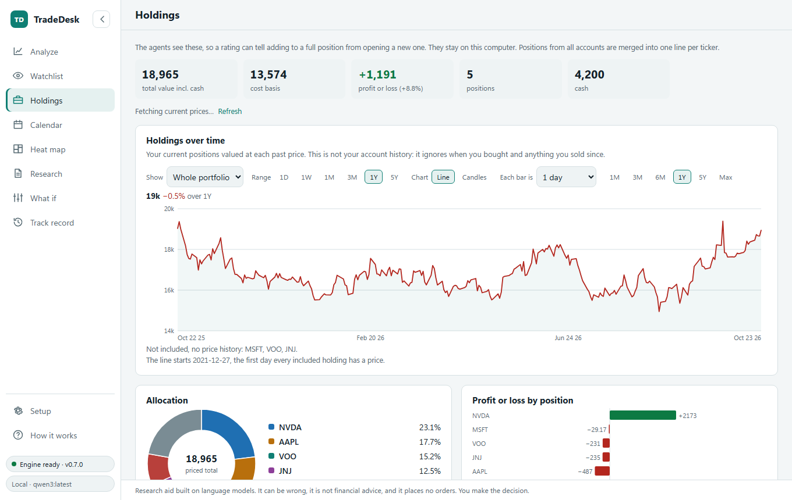

Quick buttons above the chart switch the view in one click: **1D** (5-minute bars), **1W** and **1M** (hourly bars, like Robinhood or Yahoo Finance), **3M**, **1Y** and **5Y** (daily and weekly bars). The change over the range is printed beside them. The chart shows a line or **candles** for the whole portfolio or one holding, with each bar a minute (1, 5 or 15), an hour, a day or a week. It values the positions you hold **today** at past prices, so it is not your account history, and whole-portfolio candle highs and lows are outer limits. Yahoo keeps 1-minute bars for about a week, 5 and 15 minute bars for about 60 days and hourly bars for about two years.

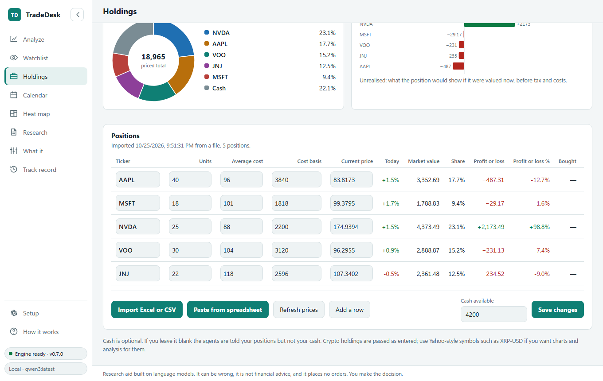

The table **sorts** on any column (click a header; click again to reverse, a third time to restore the order). **Current price** and **Cost basis** can be typed over: a typed price is marked, kept when you save, used everywhere in the app, and the arrow beside it returns to the live price. **Refresh prices** fetches new quotes. The importer understands Stock, QTY, Current Price, Purchase Price, Current total, Bought At and Profit/Loss, merges accounts into one line per ticker, and can add to your holdings instead of replacing them.

### Calendar and what the market did

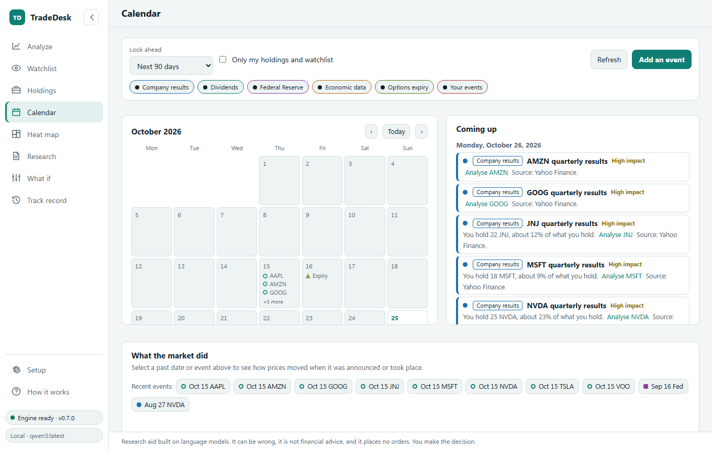

Upcoming dates that can move prices: quarterly results and dividends for your holdings and watchlist (Yahoo Finance), Federal Reserve rate decisions (federalreserve.gov, 2027 dates tentative), inflation, jobs, producer price and job-openings releases (Bureau of Labor Statistics) and options expiry (calculated). A year of past events is kept.

Each day lists up to three events. The **shape and colour give the type** and the text says who or what:

| Marker | Meaning | Text on the day |
|---|---|---|
| Circle | Company results | the ticker |
| Ring | Dividends | the ticker |
| Square | Federal Reserve | Fed |
| Diamond | Economic data | CPI, Jobs, PPI, JOLTS |
| Triangle | Options expiry | Expiry |
| Bar | Your own events | your title |

A heavy outline marks a day with a high-impact event, and past days are shaded. Events with no fixed public date, such as product launches or conferences, are not in any free feed: add them with **Add an event**.

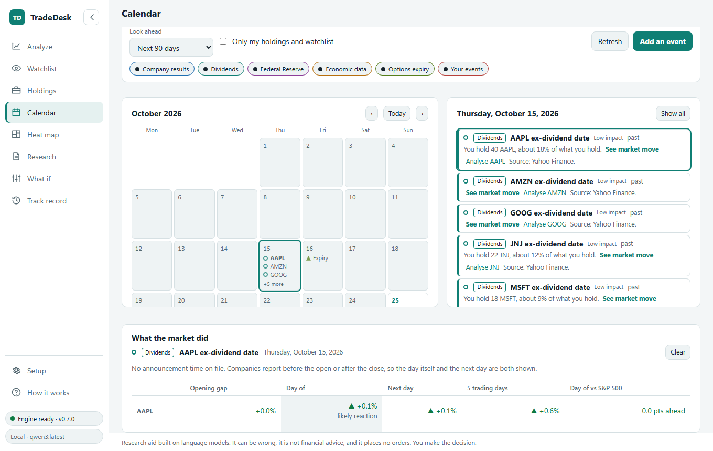

Select a past day, or press **See market move** on a past event. The section below shows the opening gap, the day itself, the next day and five trading days after, for the stock and the S&P 500 (for market-wide events, the S&P 500 and Nasdaq 100), how far ahead of or behind the market the stock was, and a chart from the close before the event. It names the likely reaction day from the announcement time: news after the close reacts the next day, news before the open or during trading reacts that day, and with no time on file both days are shown. For events announced during trading within about two months, it adds the move after 30 minutes, 2 hours and to the close. A move on the day of an event is not proof the event caused it, and it says what happened, not what will.

### Heat map

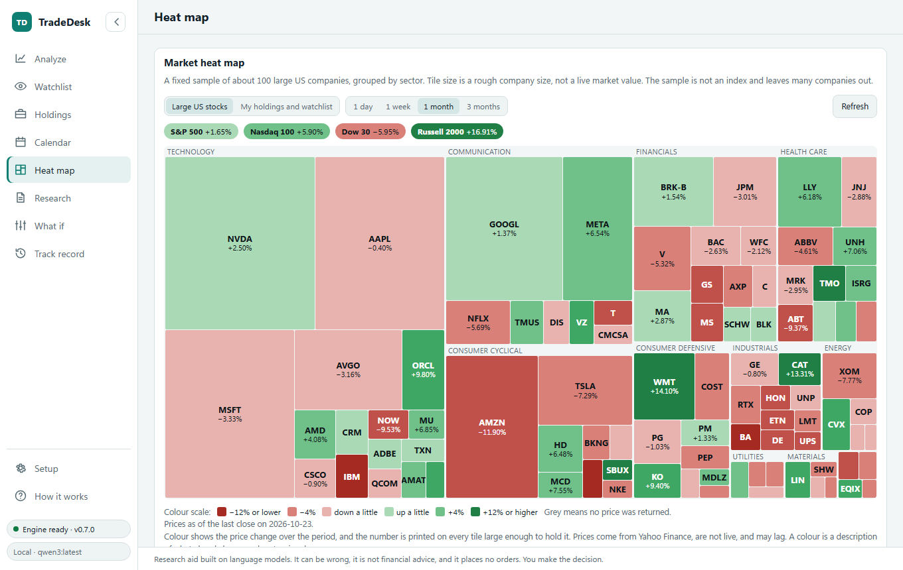

A treemap in which each tile is a company, grouped by sector. Colour is the price change over the period you pick (1 day, 1 week, 1 month, 3 months) and the number is printed on every tile large enough to hold it, so colour is never the only signal. **My holdings and watchlist** swaps the sample for your own tickers: holdings are sized by what you hold, watchlist tickers get a modest equal size, and the Holdings, Watchlist, Both selector applies. Click a tile to open that ticker in Analyze.

The large-company list is a fixed sample built into the app. Tile size is a rough company size that is not refreshed, so it is a picture of price moves, not an index or a market-value ranking. Prices come from Yahoo Finance at the last close and may lag.

### Research

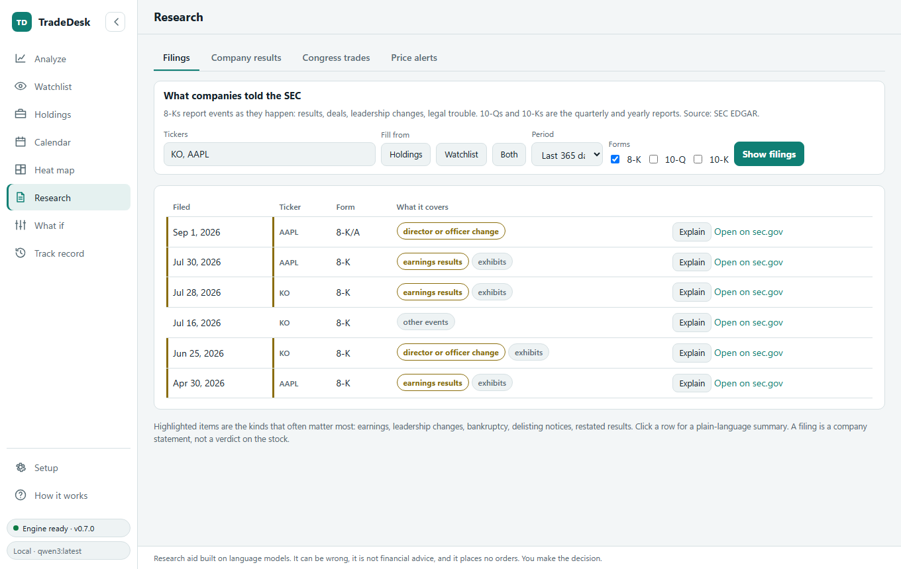

**Filings** lists what the companies you hold or watch told the SEC. An 8-K reports an event as it happens; the app names the items in plain words (earnings results, director or officer change, bankruptcy, delisting notice, restated results) and highlights the kinds that often matter. **Click a row** for a plain-language window: what the form is, each item in the filing with what that kind of item usually means, the opening of the text actually filed, and the figure lines from the attached press release. It is a reading aid cut from the filing, not a verdict on the stock, and the original is one click away on sec.gov. Tickers can be filled from your holdings, your watchlist or both.

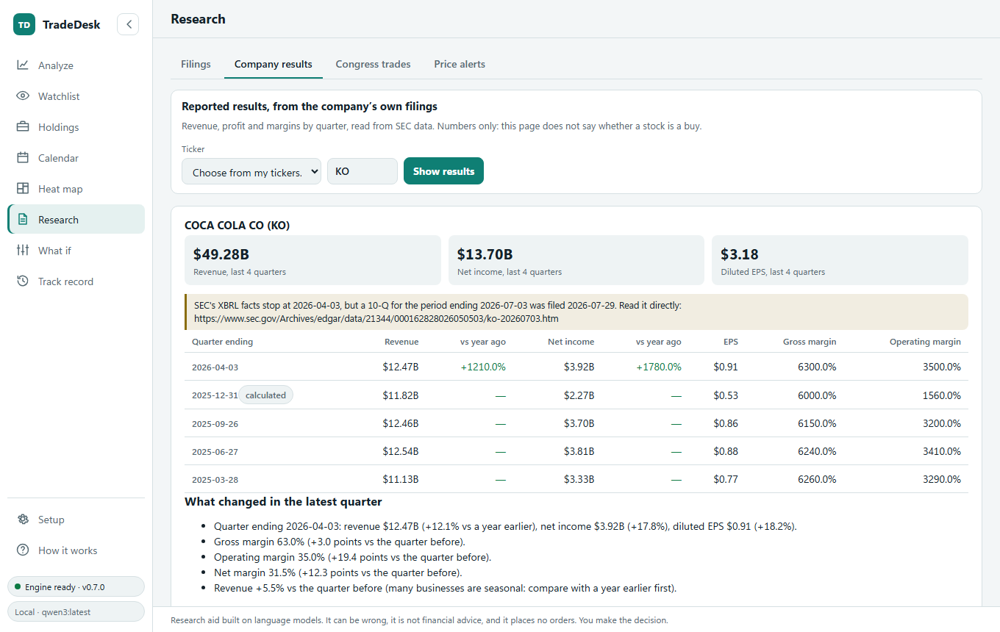

**Company results** shows revenue, net income, EPS and margins for recent quarters, the change against a year earlier, a plain sentence on what changed, and a note when SEC's structured data lags a report that is already filed. The fourth quarter is the year minus the first three and is marked as calculated. Numbers only: it does not say whether a stock is a buy. The ticker is a drop-down of your holdings and watchlist, with a box for any other.

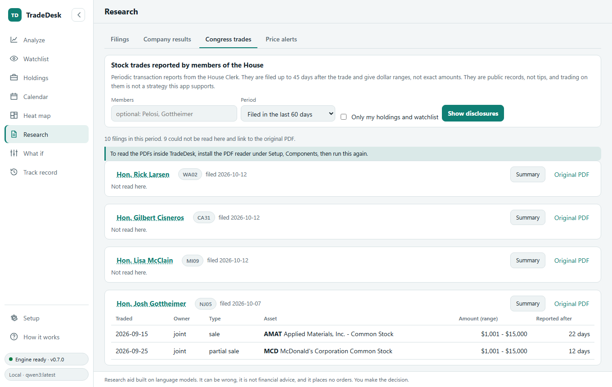

**Congress trades** reads periodic transaction reports from the House Clerk. Reports arrive up to 45 days after the trade and give dollar ranges, not exact amounts, so this is a record of what was filed, not a signal. **Click a member's name** for a summary of that report: how many transactions, purchases against sales, the companies involved, the combined size as a range, any reported late, and each line as filed. Federal law limits using these records to sell products or raise money. Reading the PDFs needs `pdftotext` (poppler) or the optional PDF reader (`pypdf`), which Setup, Components can install on its own; without either, the filings are listed with a link to the original.

**Price alerts** keep a list of prices you want to be told about. TradeDesk checks every five minutes while it is open and the engine is installed, shows a desktop notice once, and marks the alert as reached. Alerts stay on your computer; prices come from Yahoo Finance and can lag.

The SEC requires every program to identify itself with a name and email. Enter yours under **Setup, SEC contact**. It is sent only to the SEC.

### What if

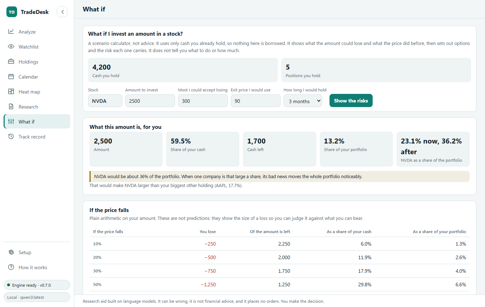

Enter a stock, an amount, optionally the most you could accept losing and an exit price you would use, and how long you would hold. The screen works only with **cash you already hold** (from Holdings or the Setup override): an amount above it is refused, so nothing is borrowed or assumed.

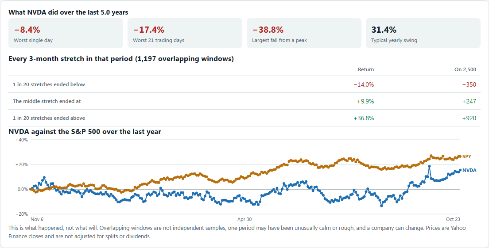

It then shows, in this order: what the amount is for you (share of cash and of the whole portfolio, and the stock's weight before and after); the loss at a 10, 20, 30 and 50 percent fall and at zero; what the stock did over five years (worst day, worst 21 days, largest fall from a peak, and where one in twenty stretches of your holding period ended); the fall that would use up your own loss limit and how often the stock has fallen that far; the loss at your exit price and a warning that a price can jump past it; and upcoming earnings and recent major filings.

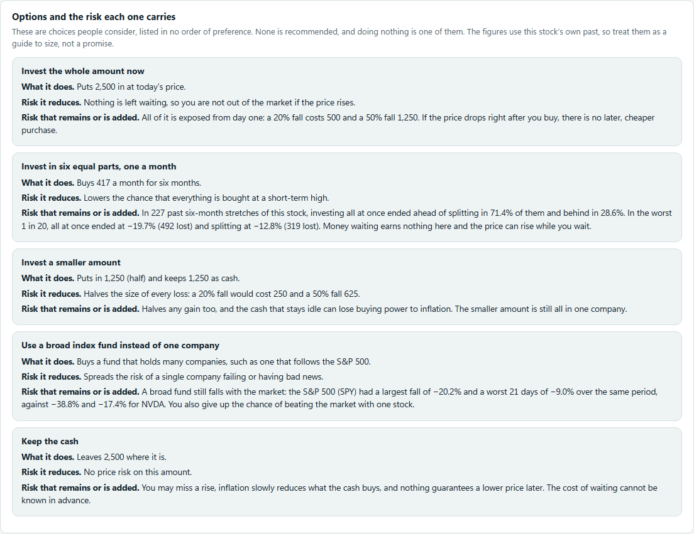

Last come **options and the risk each one carries**: invest it all now, invest in six monthly parts, invest half, use a broad index fund, or keep the cash. Each says what it does, what risk it reduces and what risk remains or is added, using the stock's own history. They are listed in no order, none is recommended, and doing nothing is one of them.

This page is a calculator, not advice. It never sizes a trade, ranks the options or forecasts a price. A calculation on past prices cannot see tomorrow's news, and the tests check that the page carries no buy, sell or "best option" wording.

### Watchlist and track record

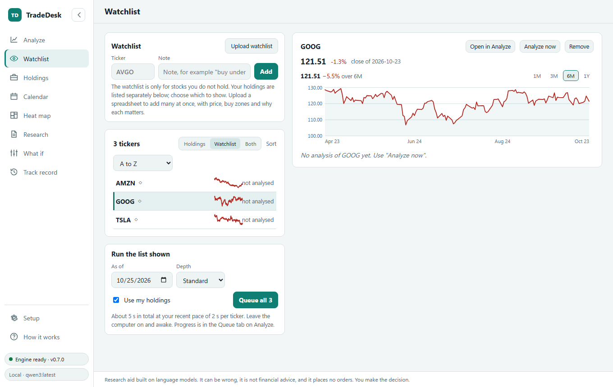

**Upload watchlist** (on the Watchlist, and on My tickers in Analyze) adds many tickers at once from an Excel or CSV file, or from a table pasted out of a spreadsheet. Name the columns in the first row:

| Ticker | Today's price | Strong Buy | Good Buy | Acceptable | Avoid | Why it's priority |
|---|---|---|---|---|---|---|
| AMD | 105 | under 95 | 95-105 | 105-115 | 150 | Data center share gains |

Only Ticker is required. Column names are matched by wording (Symbol, Price and Reason also work), a preview shows what was found before anything is saved, and you choose to add to the watchlist or replace it. Holdings are never touched.

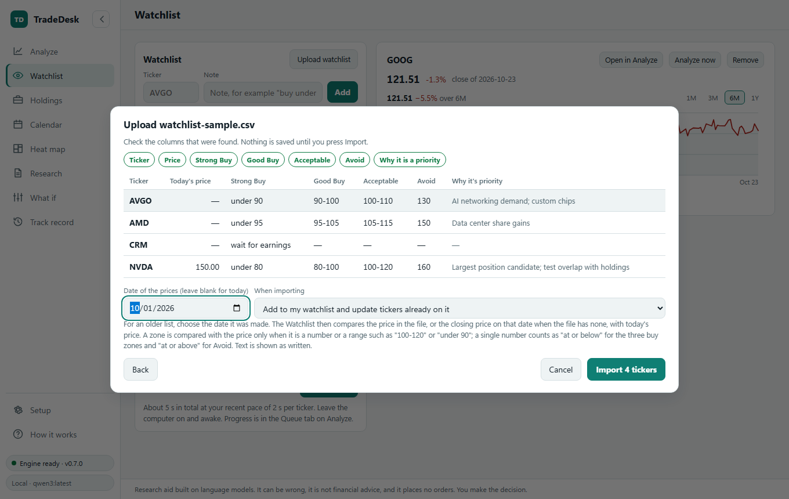

For an older list, enter the date it was made. The Watchlist then shows the price in the file, or the closing price on that date when the file has none, beside today's price and the change between them.

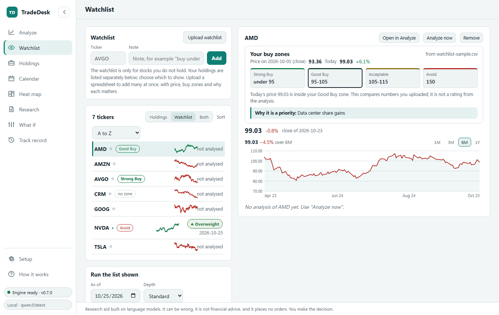

Each ticker shows your four zones and your reason. A zone is compared with today's price only when it is a number or a range ("100-120", "under 90"); a single number counts as "at or below" for the three buy zones and "at or above" for Avoid, and anything written in words is shown as written and never compared. The badge on the list says which zone the price is in, and it describes your own numbers: it is not a rating from the analysis.

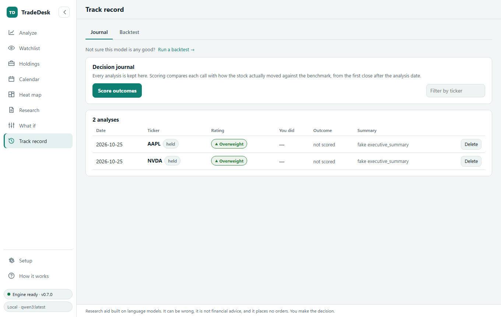

The journal's "Score outcomes" compares each call with the benchmark and compares following the rating with going against it. Each result also shows how that rating fared in your own backtests on the same model, with the sample size.

### Setup, and a menu that folds away

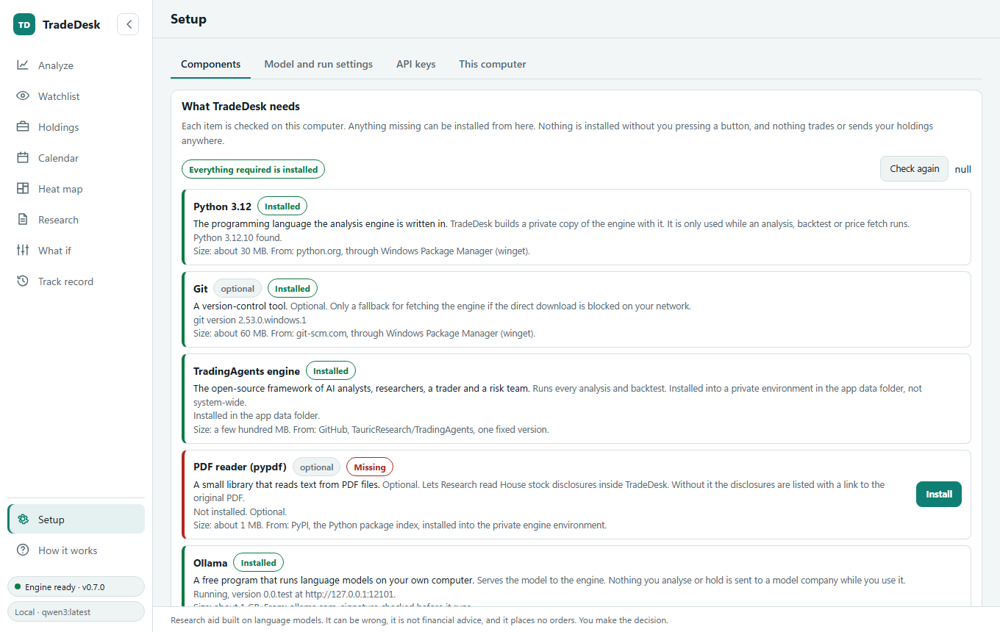

**Components** lists everything TradeDesk needs, marks what is missing, says in a line what each item is for, how big it is and where it comes from, and installs it. Press **Install everything missing**, or install items one at a time. Models download through Ollama with a progress bar, and **This computer** shows your hardware and how well each model should fit.

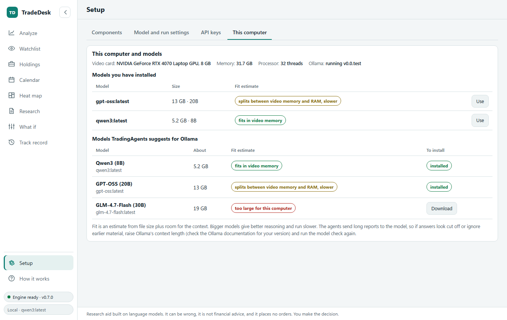

The left menu has an icon for every screen. The arrow beside the app name, or **Ctrl+B**, folds it to icons only, and the choice is remembered. **Alt+1** to **Alt+9** jump to a screen in menu order (Analyze, Watchlist, Holdings, Calendar, Heat map, Research, What if, Track record, Setup, How it works). Panes can be resized: drag any divider on Analyze or the Watchlist. Arrow keys move a focused divider and a double click resets it.

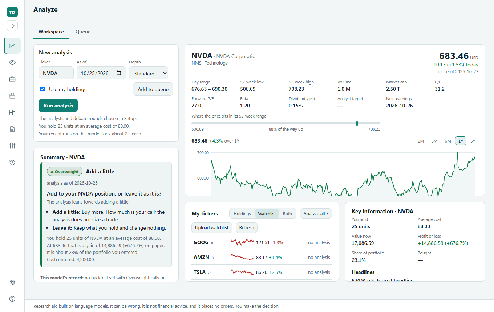

On every launch a notice says the app is not a trading recommendation and gives no advice; you must tick a box to continue.

## How an analysis works

TradeDesk does not do the analysis itself. It runs TradingAgents (version 0.7.0, one fixed commit) in a private Python environment and adds the holdings, scoring, briefing and interface around it. In outline, a run goes through these stages:

1. **Analysts** each gather their own data with tools and write a report: market (prices and indicators), sentiment, news (company and global) and fundamentals (statements, balance sheet, cash flow, insider transactions). Depth and Setup choose which analysts run.
2. **Researchers** argue the bull and the bear case over one or more rounds. A **Research Manager** weighs the debate into a plan.
3. A **Trader** turns the plan into a proposed action.
4. A **risk team** (aggressive, neutral and conservative views) debates that proposal.
5. The **Portfolio Manager** gives the final rating on a five-step scale: Buy, Overweight, Hold, Underweight, Sell. If no rating can be read, TradeDesk shows `REVIEW` and asks you to read the text.
6. TradeDesk then writes the **briefing** (reasons for and against, with checked quotes) and stores the run in the journal.

Two models take part: a *quick* model for the analysts, researchers and trader, and a *deep* model for the managers. They can be the same. The ratings are the framework's own output; TradeDesk adds the wording of the decision card with fixed rules, never a trade size.

## Install

### The Windows installer

Electron is bundled in the installer, so people you share it with need no Node.js, npm or Electron. On a Windows computer with Node.js 22 or newer, double-click `build-installer.bat` (or run `npm install` then `npm run dist`). It produces `dist\TradeDesk-Setup-<version>.exe`: a normal installer with a choice of folder, a desktop shortcut and a Start menu entry. The workflow in `.github/workflows/release.yml` builds the same installer on GitHub and adds a SHA-256 checksum.

The installer is not code-signed, so Windows SmartScreen shows "Windows protected your PC" on first run. Choose **More info**, then **Run anyway**. Removing the warning needs a purchased code-signing certificate.

### Quick start from the downloaded source

Download or clone the repository, then double-click **`start.bat`**. On the first run it:

1. checks for Node.js 22 or newer and, if it is missing, offers to install it with Windows Package Manager (or opens the Node.js download page);
2. installs the app's packages (`npm install`, about 250 MB including Electron);
3. starts TradeDesk.

Later runs skip straight to step 3. `start.bat debug` keeps the window open and shows messages. If Windows says "Windows protected your PC" about the file, choose **More info**, then **Run anyway**. Python, Ollama and the models are installed afterwards from inside the app (see First run below).

Or from a terminal, with Node.js 22 or newer already installed:

```
npm install
npm start
```

### First run

1. Open **Setup, Components**. Press **Install everything missing**, or install items one at a time. In order: Python 3.12 (through Windows Package Manager), the TradingAgents engine (a private environment inside the app's data folder, nothing system-wide), Ollama (downloaded from ollama.com, its digital signature checked, then installed) and the model chosen in Model and run settings.
2. Windows may ask for permission during the Python and Ollama installs. Press Yes. A model is several gigabytes, so allow time.
3. Open **Model and run settings** and press "Save and check this model". Both the quick and the deep model must be installed in Ollama. All three checks (answers, tool calls, structured output) must pass.
4. Import your holdings on the Holdings page.
5. Run one analysis on a ticker you know well and read it critically.
6. Run a Backtest before trusting the model with anything that matters.

Where an item cannot be installed automatically (no Windows Package Manager, or not Windows), its row links to the official download page. Git is optional and only a fallback for fetching the engine.

## Apps and tools it uses

| Part | What it is | What TradeDesk uses it for | Where it comes from |
|---|---|---|---|
| Electron | Desktop app shell (Chromium and Node.js) | The window, menus, secure key storage | electronjs.org, MIT |
| Node.js | JavaScript runtime | Build and tests; ships inside Electron | nodejs.org, MIT |
| Python 3.11 to 3.13 | Programming language | Runs the analysis engine | python.org (installed with winget) |
| [TradingAgents](https://github.com/TauricResearch/TradingAgents) 0.7.0, commit `e8f5503` | Open-source multi-agent research framework | The analysts, researchers, trader and risk team | Apache-2.0, installed from GitHub |
| Ollama | Local model runner | Serves the language model on your computer | ollama.com, MIT; installer signature checked |
| A language model (for example qwen3, gpt-oss) | Open-weight model | Writes the analysis. Each model has its own licence; check it before commercial use | Ollama library |
| yfinance | Python library | Prices, history, company data, dividends and earnings dates from Yahoo Finance | Apache-2.0. Yahoo data is for personal use |
| LangChain, LangGraph | Python agent libraries | Pulled in by TradingAgents to run the agents | MIT |
| pandas, NumPy, stockstats | Python data libraries | Price maths and indicators | BSD, MIT |
| ExcelJS | JavaScript library | Reads Excel holdings files | MIT |
| electron-builder | Packaging tool | Builds the Windows installer | MIT |
| Windows Package Manager (winget) | Microsoft's installer | Installs Python (and Git, optionally) | Built into current Windows |
| Playwright with Chromium | Browser automation | Development only: screenshots and interface tests | Apache-2.0 |
| [day-trader-skill](https://github.com/Jakeschincariol/day-trader-skill) code, commit `3d0f4ef` | SEC filing, SEC results and House disclosure parsers | The Research screen reads filings, results and disclosures with these three files, unmodified (`engine/dts`). No trading logic is used | MIT, Jake Schincariol. See [THIRD_PARTY_NOTICES.md](THIRD_PARTY_NOTICES.md) |
| pypdf (optional) | Python library | Reads House disclosure PDFs when poppler is not installed | BSD-3-Clause |
| Data sources | Yahoo Finance, SEC EDGAR, the House Clerk, federalreserve.gov, bls.gov, optionally FRED and Alpha Vantage | Prices, filings, news, the Fed and economic calendars | Subject to each provider's terms |

Licences are summarised from each project's own statement and should be confirmed before you redistribute anything. TradeDesk does not bundle Python, Ollama or a model; it downloads them from their publishers when you ask.

## Using it

- **Queue.** Add analyses from Analyze or the Watchlist. They run one at a time, with time-left estimates for each waiting item.
- **Depth.** Fast for a quick look, Standard for your settings, Thorough for all four analysts and two rounds.
- **Crypto.** Use Yahoo-style symbols such as `XRP-USD`. Small tokens may have no data.
- **Cloud models.** Setup also allows Anthropic, OpenAI or a local server (LM Studio, llama.cpp, vLLM). Cloud providers send prompts, which can include your holdings, to that provider and bill per use. Set a spending limit with them first.

## Your data and privacy

Everything is stored locally in the app's data folder (Setup shows the exact path, normally inside `%APPDATA%`): settings, holdings, watchlist, journal, saved runs and the engine environment. Optional API keys are encrypted with Windows (Electron safeStorage); if secure storage is unavailable, a key is refused rather than written in plain text. Holdings, journals and reports are ordinary files, so protect your Windows account and disk.

`node_modules` contains downloaded software dependencies, rather than TradeDesk's saved holdings or journal. Keep it out of Git: it is large, contains platform-specific files, and can be recreated from `package.json` and `package-lock.json` with `npm ci`. The Windows installer bundles the runtime dependencies users need. App data, environment files, private keys, generated installers, and dependency folders are excluded from the source upload.

What leaves the computer: the engine fetches market data, filings and news from Yahoo Finance, SEC EDGAR and optionally FRED and Alpha Vantage, and your ticker symbols are visible to those services. The calendar fetches the Federal Reserve and Bureau of Labor Statistics schedules. Research fetches from SEC EDGAR (with the name and email you enter under Setup) and the House Clerk's disclosure site. Price alerts check Yahoo Finance. With a local model, no prompt or holding is sent to a model provider.

The app window has no network access of its own (Content Security Policy `connect-src 'none'`), renders model output as plain text only, and opens only an allow-listed set of links. The engine is started with an allow-list of environment variables, so it does not inherit unrelated credentials. See [SECURITY.md](SECURITY.md) for the October 25, 2026 review, its fixes and its limits. Do not put API keys or real portfolio data in public issues.

## Limits you should know about

- Language models can be confidently wrong. A rating is an argument, not a measurement. Read the bull and bear cases before acting.
- A small local model gives weaker analysis than a large hosted one, and a full run can take many minutes.
- Scoring is only meaningful with many decisions. With fewer than 20 the app says so. Hold ratings claim no direction and are not counted as right or wrong.
- A backtest cannot rule out that the model has seen the period in its training data, and news and filings are not archived for past dates. Treat backtest numbers as indicative.
- TradingAgents' own outcome tracking uses a 5 trading day holding window, so the Journal needs at least that many trading days before it scores a call.
- Research data is delayed and incomplete by nature: filings arrive after the event, SEC's structured data can lag a report, House disclosures arrive up to 45 days late and give ranges, and none of it is inside information. Funds and some foreign listings have no SEC results.
- The What if screen uses a stock's own five-year history. Windows overlap, one period can be unusually calm or rough, and it cannot see news or earnings that have not happened. Its figures describe size of loss, not likelihood.
- Price alerts run only while TradeDesk is open and use delayed Yahoo prices.
- Price moves around a calendar event are not proof of cause, and minute-level prices exist only for about two months.
- Yahoo Finance data is for personal use under their terms and can be delayed or wrong.
- Windows only for the automatic installs. The installer is not code-signed.

## Not verified

The automated suites cover the engine against TradingAgents at the pinned commit with a fake model, the interface in Chromium, and app logic and handlers. See [SECURITY.md](SECURITY.md) for the security review's scope.

They do not validate the following:

- Installing and upgrading the Windows setup file on a clean PC. Native Electron startup and `npm run dist` were checked locally; the installer is unsigned
- Engine installation on a real computer. The installer logic is tested with fakes only
- Python and Ollama installation, and the Ollama installer's publisher check, which was tested with simulated signatures
- Real model behaviour: speed, tool calling and structured output on your model. The model check exists for this
- Live SEC EDGAR and House Clerk requests, including what the SEC returns for your contact line and whether `pdftotext` or `pypdf` can read every House PDF layout. Tests use saved samples
- Desktop notifications for price alerts on Windows
- Your own watchlist layout. The reader matches column names by wording, shows a preview, and data to be confirmed for unusual layouts or zone wording
- Broad live market-data coverage, including the heat map's 100-ticker request, its colours against a real market, and Yahoo's earnings-dates feed. One live SPY quote/history request was checked; that does not validate every symbol or endpoint
- The Bureau of Labor Statistics feed. If it refuses the request, the Calendar says so and shows the release dates saved with the app, which cover upcoming releases only
- Whether a real local model writes a briefing whose quotes survive the check
- The `nvidia-smi` GPU reading and the memory-fit estimates
- Your real spreadsheet. The importer shows a preview, but your layout is data to be confirmed

## Development

```
npm test            # logic, process, component and security tests, no Electron needed
npm run test:py     # briefing, market bars, calendar, event-move and research tests (requires pandas)
npm run test:electron # native Electron startup and IPC smoke check (requires Playwright)
TD_PY=/path/to/venv/python NODE_PATH=$(npm root -g) npm run test:ui
TD_PY=/path/to/venv/python NODE_PATH=$(npm root -g) node docs/make-screenshots.js
```

`test:ui` loads the real interface in Chromium, drives the real IPC handlers and the real Python engine, and replaces the model with a fake local server and market feeds with deterministic fixtures. It covers the launch notice, the Research and What if screens, boot, setup, model check, holdings import and charts, the four-pane Analyze page, the briefing and its quote checks, news, queue, cancel, failure, watchlist, calendar, track record, backtest, link and path safety, and layout at three window sizes. It needs Playwright and its Chromium browser; set `TD_CHROMIUM` to use an existing Chromium.

`test:electron` launches the actual Electron main process and preload with a fresh temporary user-data folder, then checks native IPC, settings persistence, a sample watchlist import, and sandbox preferences. It uses no existing portfolio or saved keys. The screenshot generator also accepts `TD_CHROMIUM`.

## Project layout

```
engine/tradedesk_engine.py   wraps TradingAgents; one job per process, JSON lines on stdout
engine/briefing.py           the reasons-for-and-against briefing with checked quotes
engine/research.py           filings, one filing read in plain words, company results and House disclosures (commands filings, filing, facts, congress)
engine/dts/                  three parsers vendored from day-trader-skill (MIT), unmodified
src/main.js, ipc.js          Electron shell and handlers (every handler checks the calling frame)
src/security.js              sender check and the engine's environment allow-list
src/components.js            what is installed, and the installers for Python, Ollama and models
src/setup.js                 Python discovery and engine install
src/holdings.js              CSV and Excel import, merge, average cost
src/scoring.js               journal scoring
src/profiles.js              Fast, Standard and Thorough depths
src/store.js                 local files, encrypted keys
renderer/                    interface (no inner HTML, no remote content)
renderer/advice.js           the "decision for you" wording (fixed rules, no model)
renderer/portfolio.js        allocation, profit or loss, holdings-over-time maths
renderer/charts.js           small SVG charts (line, candles, comparison, donut, bars)
renderer/calendar.js         the Calendar, labelled days and the market-move section
renderer/heatmap.js          the Heat map (treemap layout and colours)
renderer/watchimport.js      the watchlist upload window; renderer/zones.js reads the buy zones
src/watchlist.js             reads a watchlist table
renderer/research.js         Research tabs and the price-alert check
renderer/whatif.js           the What if page
renderer/risk.js             the loss and history arithmetic behind it (pure, unit tested)
renderer/split.js            draggable dividers
docs/                        screenshots and the script that regenerates them
tests/                       logic, process and security tests, UI harness, fake model server
```

## Licence, credits and disclaimer

TradeDesk is currently all rights reserved; no licence to copy or reuse it has been granted. It is built on [TradingAgents](https://github.com/TauricResearch/TradingAgents) by Tauric Research (Apache-2.0), Ollama, yfinance and the other projects listed above, and does not claim their work. The Research screen's parsers come from [day-trader-skill](https://github.com/Jakeschincariol/day-trader-skill) by Jake Schincariol (MIT); see [THIRD_PARTY_NOTICES.md](THIRD_PARTY_NOTICES.md).

This software is provided as is, for research and education. It is not investment, legal or tax advice, it does not know your circumstances, and its output may be wrong. You are responsible for your own decisions and for following the terms of every data provider you use.
